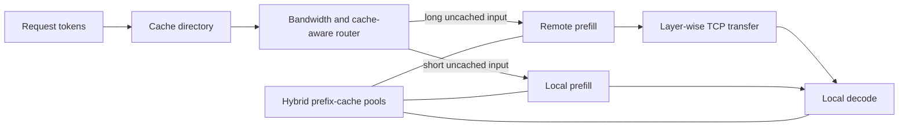

# prefill-relay

prefill-relay routes long-context prefill to remote compute, keeps shorter work local, and transfers hybrid KV state over TCP for local decode. It includes a capacity model, a scheduling controller, a bounded prefix-cache pool, and an executable GPU correctness demo.

## Quick start

The scheduling, cache, transport, and analytical modules use Python 3.10+ and the standard library. Use `uv` to install the project and run commands; `uv.lock` pins its dependencies. The project selects Python 3.10, and the GPU extra pins the validated PyTorch 2.6.0 release.

```bash
git clone https://github.com/AniketKul/prefill-relay.git
cd prefill-relay
uv sync --locked
uv run --locked prefill-relay search config/example.json --output docs/results/illustrative
uv run --locked python -m unittest discover -s tests -v
```

For an existing checkout at `~/prefill-relay`, start with `cd ~/prefill-relay`. Python imports use `prefill_relay`; the CLI command is `prefill-relay`.

The search command writes a JSON comparison, the complete grid in CSV, and an SVG chart. The bundled profiles are **synthetic examples**. Replace them with measured profiles to evaluate your hardware. Capacity estimates do not measure queueing latency or time to first token.

## GPU demo

The optional PyTorch backend performs real tensor computation with a small, deterministic, untrained model containing three recurrent linear-attention layers and one causal full-attention layer. It validates cache handoff and incremental decoding against full recomputation.

Install the GPU extra with `uv`:

```bash
uv sync --locked --extra gpu
```

Then run:

```bash
PREFILL_RELAY_TEST_DEVICE=cuda uv run --locked --extra gpu python -m unittest discover -s tests -v
uv run --locked --extra gpu prefill-relay demo --device cuda \
  --prompt-tokens 2048 --prefix-tokens 512 --decode-tokens 16 --connections 4
```

Use `--device cpu` for CPU execution. Tests requiring PyTorch explicitly skip when it is absent. The demo covers cold remote prefill, a longer prefix cached remotely than at decode, prefix migration when bandwidth is available, and short local prefill. Every generated decode step is checked against monolithic inference.

## Architecture



| Component | Behavior |
|---|---|
| `analytics.py` | Models compute, aggregate egress and decode capacity; searches thresholds and integer role allocations |
| `scheduler.py` | Selects local or remote prefill using valid cache matches and bandwidth availability |
| `cache.py` | Shares bounded storage between reusable prefix blocks and pinned transfer blocks |
| `transport.py` | Streams layers across multiple TCP connections with checksums, backpressure and application acknowledgements |
| `tiny_model.py` | Computes hybrid attention, encodes tensors without pickle, and applies cache deltas |
| `demo.py` | Connects routing, prefix caching, real TCP transfer and incremental decode |

### Capacity and scheduling

Profile sizes are bytes, service times seconds, and context lengths tokens. Configuration bandwidth is decimal Gbps. Profiles interpolate linearly and reject extrapolation; provide coverage for your workload bounds. Workloads use a truncated lognormal distribution.

Remote prefill capacity is the smaller of compute capacity and aggregate egress capacity. Local prefill is limited by compute, while decode capacity depends on batch size, step time and output length. End-to-end capacity accounts for the fraction of requests assigned to each prefill path. The search compares selective offload, a homogeneous local deployment, and a deployment that sends every prefill remotely.

`Controller.update()` accepts effective bandwidth, utilization, queue depth, monotonic time and optionally an updated workload. Short-term triggers search the routing threshold while preserving the local role split. Periodic updates search both threshold and allocation. Default triggers are utilization 0.85, queue depth 8 and a 60-second allocation interval. The caller supplies telemetry and applies allocation recommendations after draining affected nodes.

### Cache and transfer correctness

A reusable hybrid prefix requires complete full-attention blocks and a recurrent checkpoint at the exact same token position. Model namespaces isolate cached state. Recurrent state cannot be truncated to an earlier prefix. The demo saves checkpoints at complete 16-token boundaries.

When the producer has a longer cached prefix than the decode destination, the transfer includes all full-attention KV missing at decode and the complete final recurrent states. Applying a delta verifies the destination prefix identity. Layer transfers begin as layers finish, with bounded outstanding frames.

Transfer blocks remain pinned until acknowledgement or explicit abort. After a failed multi-layer send has settled, call `Receiver.discard(request_id)` to release partial frames. Receiver shutdown waits for active handlers to finish or reach their socket timeout.

## Validation

[The verification receipt](docs/results/verification.json) records test commands, GPU environment and the source-manifest hash. [The H100 demo output](docs/results/h100-demo.json) records each path's transferred bytes, generated tokens and numerical error.

Validation uses one H100 and TCP loopback. Demo timing includes CPU staging and serialization; it is not a cross-datacenter performance measurement. The synthetic search results are separate from GPU measurements.

## Current boundaries

This is an experimental implementation. The cache directory and storage are in-process and host-memory-only. Production integration requires a trained inference backend, persistent/distributed cache storage and metadata, cluster orchestration, actual network telemetry, and deployment-level testing.

The receiver binds to loopback by default. Checksums and allocation bounds do not provide authentication or encryption; keep the transport within a trusted test environment. Application acknowledgements confirm individual frame delivery, not distributed exactly-once execution.

The tiny model uses float32 and supports at most 8192 tokens. It is a numerical correctness backend, not an optimized language-serving engine. No production-readiness or large-model performance claim is made.
