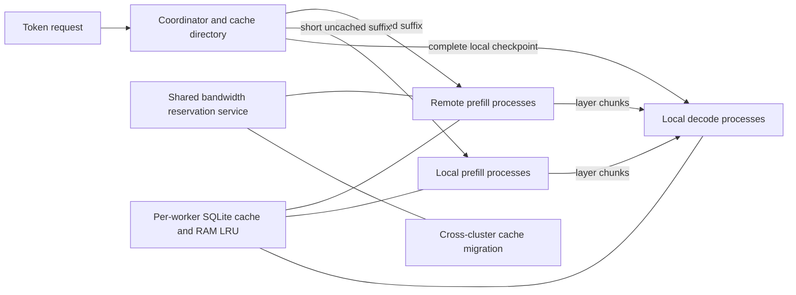

# Architecture

The coordinator routes requests, reserves workers, and manages cache placement. Each model worker owns a model instance, a persistent cache, a cache HTTP service, and a TCP state receiver. Local workers can change between prefill and decode roles; remote workers perform prefill.

## Request path

1. Probe live cache metadata using the exact model namespace and token prefix. Prefer longer reusable prefixes, then lower load. A complete checkpoint already on an available decoder bypasses prefill and transfer, including when remote bandwidth is unavailable.
2. Choose the prefill cluster from uncached length and effective bandwidth. Scarce bandwidth uses the local cache match for the routing decision; abundant bandwidth can use the longer match across clusters and migrate it to the selected producer. Equality with the threshold routes locally.
3. Reserve a producer and decoder. Restore the producer's exact checkpoint, compute the suffix, and stream state as layers become ready. Trained prefill uses bounded input chunks; callbacks occur during the final chunk so every transferred layer describes the same completed prompt.
4. The decoder reconstructs state against its own cached prefix and checks the first token against the producer. Only full-attention KV missing at the decoder is sent; recurrent states are replaced by their complete final checkpoints.
5. Decode compatible requests together. Batches require equal cache lengths, requested output counts, model identities and tensor schemas. The tiny backend runs single requests. The returned result includes generated tokens, transfer bytes, timing, placement and batch information.

The coordinator's TTFT is first-token readiness after reconstruction, not a timestamp measured by a streaming external client. The public Python call returns the completed generation.

## Cache invariants

`PersistentHybridCache` stores reusable tensor blocks in SQLite with WAL and full synchronous transactions. A bounded RAM LRU fronts disk reads. A file lock gives each database one owning process; authenticated HTTP clients share that owner.

A usable prefix needs all full-attention blocks and a recurrent checkpoint at exactly the same token position. A saved checkpoint can end inside a token block. A partial block is valid only for its exact tokens and checkpoint; recurrent state cannot be truncated to manufacture an earlier hit. Checkpoints are stored at completed request prefixes rather than every possible token position.

Namespaces bind the model revision, configuration, dtype and adapter identity. The tensor codecs check dimensions, byte counts and checksums without using pickle. Cache lookup also validates block integrity; corrupt or incomplete entries are excluded.

Reusable blocks and temporary transfer pins share the configured allocation budget. Pins remain until an acknowledgement or explicit abort. Restart clears unfinished transfer records while retaining reusable checkpoints. The budget counts stored payload blocks; SQLite metadata, WAL files and serialization scratch space require additional host storage and memory.

`GlobalDirectory` keeps explicit membership and load metadata and probes nodes for current matches. Migration compares destination block hashes and sends missing full-attention blocks plus complete recurrent state. The source stages the delta in its shared allocation pool; the receiver must retain a verified checkpoint before the source releases that pin. Rebalancing copies a hot prefix from a busier holder to an eligible lower-load node. Cross-cluster replication is opt-in and charged to the same rate service as inference transfers.

The directory is not a replicated ownership log. Restart requires node registration again; persisted cache data remains with its node.

## Transfer and bandwidth

Each transfer streams bounded layer chunks across up to the configured number of TCP connections. A sender thread reuses its socket for successive frames until the request ends or a connection error forces it to reconnect. The sender retries unacknowledged frames, and the receiver checks duplicates before admitting them. Sender statistics include the number of sockets opened and frames acknowledged. During placement, the scheduler samples active remote sends for progress, retry counts and per-socket retransmission deltas. Checksums, explicit acknowledgements, bounded outstanding sends, receiver byte limits, idempotent frame retries and aborted-request cleanup protect the handoff. A frame acknowledgement confirms that frame, not distributed exactly-once execution.

`RateService` shares a monotonic reservation clock across independent processes. Remote tensor frames and cross-cluster cache deltas reserve bytes before sending. This prevents every sender from independently claiming the full configured bandwidth while allowing producers to compute concurrently. Changes affect new reservations; previously allocated slots retain their deadlines.

This is application-level pacing of payload bytes. Frame bursts, HTTP/control traffic, kernel buffering and physical network behavior are not a WAN emulator. Sender telemetry includes bytes, elapsed time, failures and retries; Linux `TCP_INFO` adds RTT and retransmission counters. Other platforms report those kernel fields as unavailable.

## Feedback and role changes

The controller searches a finite grid of thresholds and integer local prefill/decode allocations using supplied service-time and cache-size profiles. Interpolation stays within the measured token range. Runtime observations come from actual uncached suffix lengths; complete hits are recorded separately and bypass the miss-distribution model.

Short-term updates respond to effective bandwidth, utilization and queued bandwidth reservations. Periodic updates can change both routing threshold and worker roles. `RolePool` stops assigning work to a worker being changed and applies the new role only after its active reservations drain. At least one decoder remains. Loss of remote bandwidth can trigger an emergency local allocation rather than waiting for the periodic update.

The single-host runtime currently uses the batch-1 decode profile conservatively for allocation, while its serving queue can execute larger compatible batches. All local and remote processes share the configured device. Reusing one measured profile for both clusters demonstrates control behavior; it does not establish additive hardware capacity.
